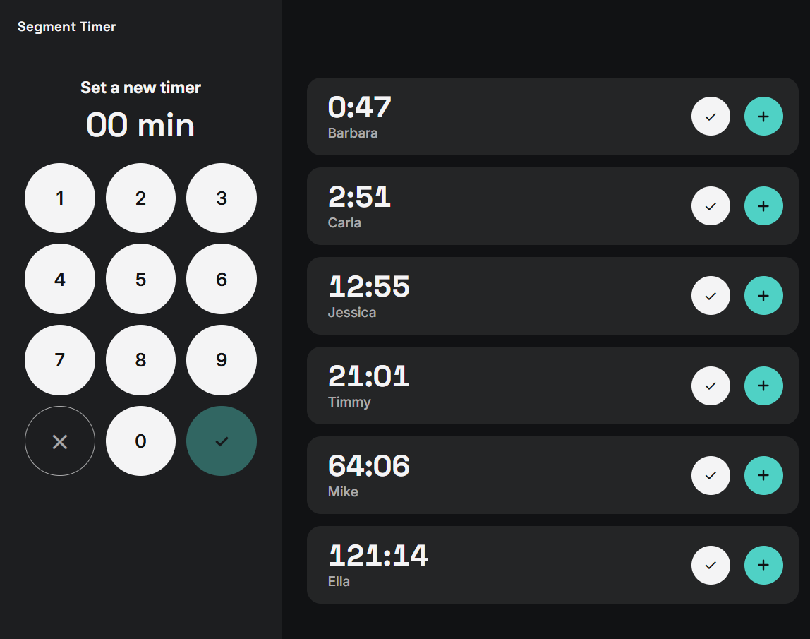

# Segment Timer

Segment Timer is a browser-based multi-timer application. Type a duration on the keypad, give the timer a name, and it counts down alongside all your others, with the least time left at the top. When a timer hits zero it goes fullscreen, keeps counting into negative time, and loops an alarm until you mark it done or add more time.

It runs entirely in the browser as a small set of static files, with no server, no accounts and no dependencies, so any static host will do.

[](https://revolut.me/leonampa) [](LICENSE)

### [Try out the Demo](https://leonampa.github.io/segment-timer/demo)



## Where it works

Anywhere you're juggling several timed things at once and need to know *which one* is up:

- **Hair salons and barbershops**: colour processing, toner, treatments and blow-dries running in parallel.
- **Beauty and treatment rooms**: facials, waxing, lash and nail services.
- **Therapy and appointment-based practices**: session timing. Names stay on the device and nothing is sent anywhere.
- **Live events**: speakers, panels and stage segments.
- **Classrooms, workshops and kitchens**: group work, lab steps, batches.

## Features

- **Any number of timers, each with a name**: a client, a speaker, a dish. Type the minutes on the keypad, then name it.
- **Sorted by urgency**: the least time left is always at the top.
- **Overtime alert**: when a timer hits zero it jumps to fullscreen, keeps counting into the negative, and loops an alarm sound until you deal with it.
- **Multiple overtime timers at once** sit side by side as slices. Once there are too many to fit, the row scrolls horizontally.
- **Add time**: on a running timer, the added minutes are added on top. On a timer that's already over time, it restarts from the amount you add (-1:20 plus 1 min becomes +1:00, not -0:20).
- **Keeps the screen awake and rings in the background.** While a timer runs, the screen stays on (Screen Wake Lock, with a hidden-video fallback), and the alarm is scheduled on the audio clock so it can ring when the tab is hidden, the app is switched away, or the screen is off. 
- **Installable (PWA).** Can be added to the home screen for the most reliable background behaviour. The app only prompts for this, in plain language, when it's useful.
- **Survives refreshes, closed tabs, and background throttling.** Each timer stores its absolute end time rather than a counter, so the remaining time is always recomputed from the clock.
- **Translatable in one place**: every user-facing string lives in a single `STRINGS` object at the top of the file.
- **Keyboard accessible**, with visible focus rings.

## Setup

Upload all the files in this repo to any static host (GitHub Pages, Netlify, Vercel, Cloudflare Pages, or your own web server), keeping them together in the same folder. There's no build step, no server and nothing to configure.

Your host must serve the site over **HTTPS**. The screen lock, background alarm, install prompt and notifications don't work without it, and every host above does this by default. Opening `index.html` straight from your computer works for a quick look, but those features stay off.

Not every file is needed to run it: `README.md`, `LICENSE`, `OFL-*.txt` and `screenshot.png` can be left out. Leave out any of the others and something stops working:

| File | What it does |
| --- | --- |
| `index.html` | The app |
| `timer.mp3` | The alarm sound. Replace it with your own; a short clip (about 1 second) works best, as it loops while any timer is over time |
| `manifest.json`, `sw.js` | Make the app installable and let it show a "time's up" notification |
| `icon-*.png`, `apple-touch-icon.png` | App icons. Replace them to brand your own copy |
| `Inter.ttf`, `SpaceGrotesk.ttf` | The fonts, both under the SIL Open Font License. If they're missing, the app falls back to your system font |


## Notes

- **Where timers are stored:** in your browser's `localStorage`. They persist on the same browser and device, but are not synced across devices.
- **Background alarms (how it works, and its limits).** While timers run, the page holds a screen wake lock, plays a near-silent tone so the browser keeps it alive, and schedules the alarm on the audio hardware clock for the moment the next timer ends. Everything is static files: there is no server and no push service. That means it is a best effort, not a guarantee. A static page cannot be woken by the OS once the browser has fully closed it, or after the device kills it for memory or battery reasons. Best results: install to the home screen, keep the device plugged in, and don't force-close the app.
- **Closing the tab entirely** still means nothing can play or alert, but when you reopen it the times are correct, and anything that expired in the meantime alerts immediately.
- **Music:** while the app is on screen it asks to mix with other audio (iPad Safari `audioSession = "ambient"`). When it's in the background or an alarm is ringing, it takes full audio priority so it can survive a locked screen and isn't muted. Behaviour varies by OS version, so test with the real setup.
- **Autoplay rules:** browsers block sound until you've interacted with the page at least once. In normal use you'll already have clicked the keypad. If an alarm is blocked after a reload, it starts as soon as you click anywhere.
- **Browser support:** current Chrome, Edge, Safari 16+, and Firefox 110+. The fullscreen slices use CSS container query units.

## Customising

### Theme

Everything is driven by a handful of CSS variables at the top of the `<style>` block:

```css
:root{
  --ink:#111214;     /* page and panel background */
  --paper:#f4f4f5;   /* text, and neutral button fill */
  --accent:#4fd1c5;  /* confirm and add-time */
  --panel: rgba(255,255,255,0.05);
  --card: rgba(255,255,255,0.08);
  --card-hover: rgba(255,255,255,0.13);
  --card-alert-hover: rgba(255,91,69,0.16);
  --divider: rgba(255,255,255,0.16);
  --muted: rgba(255,255,255,0.62);
  --alert:#ff5b45;
  --alert-tint: rgba(255,91,69,0.1);
  --focus-ring:#4fd1c5;
}
```

If you change the colors, check the contrast between text and its background.

### Translating

Open `index.html` and edit the values in the `STRINGS` object near the top. Functions receive the pieces they need, so you can reorder words or handle plurals for your language. Also set `<html lang="...">` to your language code.
